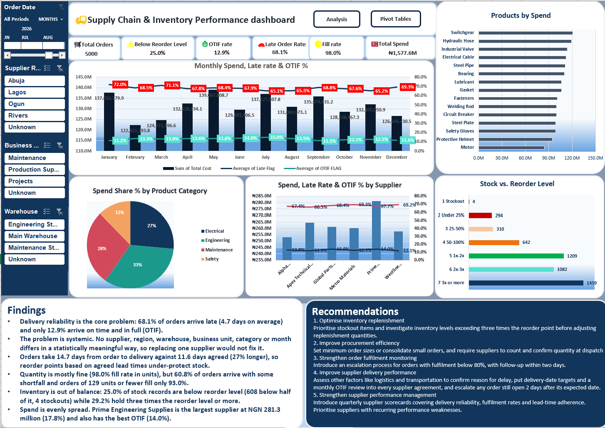

# Supply Chain Inventory & Delivery Performance Analysis

An Excel data analytics project that cleans and analyses 5,000 purchase orders (January to December 2025) to find out why deliveries are late, how reliable suppliers really are, and where inventory is at risk. The results are presented in an interactive Excel dashboard.



## Business questions

| # | Question | Answer in brief |
|---|---|---|
| 1 | What share of orders arrive late, and by how much? | 68.1% late, 4.7 days on average |
| 2 | How much quantity is missing? | 98.0% fill rate; shortfall worth 2.0% of spend |
| 3 | Which suppliers, regions or warehouses perform worst? | None differ meaningfully |
| 4 | Do real lead times match agreed ones? | No: 14.7 vs 11.6 days (+27%) |
| 5 | How much stock is at risk or in excess? | 25.0% below reorder level, 29.2% at 3x or more, 4 stockouts |
| 6 | Where does spend go? | Evenly spread across suppliers (16.0% to 17.8% each) |
| 7 | Do late deliveries cause low stock? | No link found in this data |

## What the dashboard shows
 
- **Filters:** order-date timeline plus supplier region, business unit and warehouse slicers
- **KPI cards:** total orders, total spend, OTIF, late rate, fill rate, below-reorder rate
- **Charts:** monthly spend with late rate and OTIF, spend by product and category, supplier comparison, stock level against reorder level
- **Key insights** and a **recommendations** panel

## Key findings
 
| Measure | Result |
|---|---|
| OTIF (on time and in full) | **12.9%** |
| Late order rate | **68.1%**, 4.7 days late on average |
| Lead time, agreed vs actual | 11.6 vs **14.7 days** (+27%) |
| Fill rate (units) | 98.0% |
| Records below reorder level | 25.0% (4 stockouts) |
| Records holding 3x reorder level or more | 29.2% |
 
- **Late delivery is systemic, not one bad supplier.** Only 12.9% of orders arrive on time and in full. Late rates are almost the same everywhere: suppliers range from 66.5% to 69.3%, warehouses from 66.6% to 70.3% and business units from 67.1% to 69.2%, and replacing a particular supplier is not a better option
- **Planning is too optimistic.** Orders take 27.7% longer than expected lead time, so reorder points based on agreed lead times under-protect stock.
- **Quantity is mostly fine, but small orders suffer.** Orders of 129 units or fewer fill only 93.0%; shortfalls average about 5 units whatever the order size.
- **A few badly short orders matter most.** The 4.5% of orders filled below 80% cause about 30% of the shortfall value (2.0% of total spend).
- **Inventory is out of balance.** 25.0% of stock records are below reorder level while 29.2% hold three times the reorder level or more.
- **Spend is evenly spread.** Each supplier holds 16.0% to 17.8% of spend.
  

## Data

- Source: `Source dataset.xlsx` (5,050 rows, 20 columns, 6 suppliers, 15 products, 4 categories).
- Period: 1 January to 31 December 2025.
- Currency: source amounts are in Nigerian naira (NGN).

## Data cleaning summary

| Issue | Fix |
|---|---|
| 50 duplicate orders | Removed (5,050 to 5,000 rows) |
| 13 supplier spellings, 63 product spellings, warehouse abbreviations | Standardised to 6 suppliers, 15 products, full warehouse names |
| Category typos and blanks | Corrected using a product-to-category map |
| Blank region, warehouse, business unit | Labelled "Unknown", not guessed |
| 31 order dates with day and month swapped | Rebuilt as expected delivery date minus lead time |
| 150 blank received quantities | 57 inferred from status; 93 Partial orders excluded from fill rate |
| 150 blank delivery dates | 23 inferred; 127 left blank and excluded from late rate |
| Unrealistic unit costs | Flagged, not changed; no price comparisons made |

## Method and tools

- **Microsoft Excel:** Tables, helper columns (IF, COUNTA, SUM, MONTH, RANK, COUNTIF), PivotTables, PivotCharts, calculated fields, slicers, timeline.

Key definitions: **OTIF** = delivered on or before the expected date with the full quantity. **Fill rate** = total units received divided by total units ordered (orders with unknown receipts excluded from both totals). **Late rate** is measured from the delivery delay, because the Partial status overrides Late.

## Skills demonstrated
 
- Data cleaning and validation, with every change logged
- KPI design and careful definition (weighted fill rate, consistent bases for percentages)
- PivotTables, calculated fields and helper columns in Excel
- Dashboard design: slicers, timeline, combo charts and a recommendations panel
- Analytical judgement: separating a systemic problem from a single-supplier problem, and avoiding misleading comparisons
- Turning findings into prioritised, practical recommendations

## Recommendations

1. **Reset lead times:** give a delivery date targets and a monthly OTIF review into supplier agreements and escalate any order still open 2 days after expected date
2. **Rebalance stock:** Prioritize stockout items and investigate inventory levels exceeding 3x the reorder point before adjusting replenishment quantities.
3. **Fix small orders:** set minimum order sizes or consolidate small orders, and require suppliers to confirm quantities at dispatch.
4. **Chase badly short orders:** follow up any order filled below 80% within 2 days.
5. **Strengthen Supplier Performance Management :** Introduce quarterly scorecards covering delivery reliability, fulfillment rates and lead time adherence. Prioritize suppliers with recurring performance weakness

## Limitations

- No demand or sales data, so inventory turnover and days of cover cannot be calculated.
- Stock Level and Reorder Level vary between records of the same product, so results are shares of records.
- Many differences between groups are small; the honest conclusion is that the problem is shared across the supply base.

## Repository structure

```
├── README.md
├── Source dataset
├── Supply Chain Analysis Workbook
└── Dashboard
```
Open the workbook in desktop Excel to use the slicers and timeline. The **Dashboard** sheet is the finished view, the **Pivot Tables** sheet shows the calculations, and the **Cleaned Data** sheet holds the prepared data. GitHub's preview does not show Excel's interactive features, so download the file to explore it.


## Author

Precious Obinna· //www.linkedin.com/in/precious-obinna-30b6b43a2?utm_source=share_via&utm_content=profile&utm_medium=member_ios
